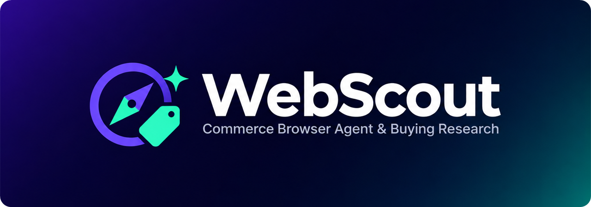
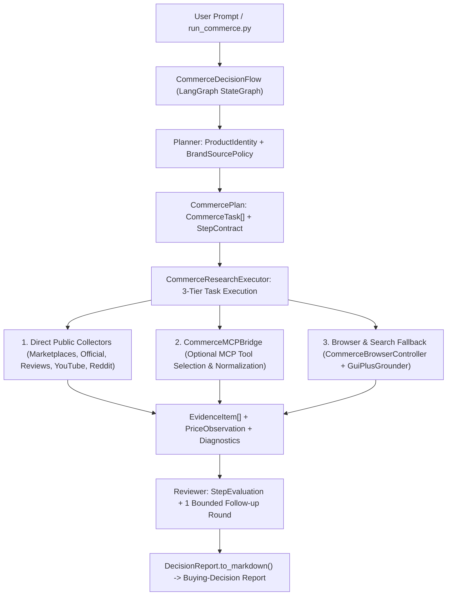

<p align="center">
  
</p>

# WebScout

English | [简体中文](README.zh-CN.md)

WebScout is a cross-platform product research, price comparison, and buying-decision agent built on top of the [OpenManus](https://github.com/FoundationAgents/OpenManus) multi-tool agent runtime.

Its primary workflow (`run_commerce.py`) plans a bounded product investigation, collects public evidence across online marketplaces, official brand stores, editorial tech media, YouTube reviews, and Reddit discussions, checks SKU comparability, and outputs a structured Markdown decision report that separates verified quotes from blocked, degraded, or missing sources.

Alongside the commerce research pipeline, WebScout preserves the underlying OpenManus general-purpose agent (`main.py`), multi-agent planning flow (`run_flow.py`), Model Context Protocol (MCP) client/server tools (`run_mcp.py`, `run_mcp_server.py`), Docker and Daytona sandboxes (`sandbox_main.py`, `app/sandbox/`), chart visualization tools (`app/tool/chart_visualization/`), and an experimental A2A protocol server (`protocol/a2a/`).

---

## Highlights

- **Policy-Driven Product Research (`product_compare_v2`)**: Extracts brand, product family, category, model, and hardware configuration (`size`, `chip`, `memory`, `storage`, `color`, `market`) from free-form requests. Automatically narrows broad configuration-sensitive prompts (such as `"MacBook Pro"`) to an explicit representative baseline (`Apple 14-inch MacBook Pro M5`) instead of mixing incompatible SKUs.
- **3-Tier Evidence Collection Pipeline**: Executes each `CommerceTask` in strict priority order:
  1. **Built-in Direct Public Collectors** (`app/mcp/commerce_public_server.py`) for Amazon, Best Buy, Walmart, Target, B&H, Newegg, official brand stores (Apple, Google Store, Samsung, Microsoft, Lenovo, Dell, HP, ASUS, Acer, Framework, Razer), retail customer reviews, 20+ editorial review sites (The Verge, Wirecutter, RTINGS, Notebookcheck, GSMArena, CNET, PCMag, etc.), YouTube, and Reddit.
  2. **Optional MCP Bridge** (`app/commerce/mcp_bridge.py`) for structured external MCP providers such as Bright Data, Playwright MCP, or custom SSE price services.
  3. **Search & Browser Fallback** (`app/commerce/browser.py`, `app/commerce/grounding.py`) with multi-engine search, headless/session browser extraction, HTML fetch fallback, and DOM + multimodal vision grounding (`GuiPlusGrounder`).
- **Honest Evidence & Diagnostics**: Filters out accessories, trade-in promos, monthly financing numbers, and mismatched models. Marks refurbished/renewed or unaligned listings as degraded samples, and surfaces login walls, CAPTCHAs, country selectors, or HTTP rate limits directly in the report rather than hiding gaps.
- **Bounded LangGraph Control Flow**: Uses a `planner -> executor -> reviewer` state graph (`CommerceDecisionFlow`) with per-step `StepContract` verification, failure-signature tracking, and at most one follow-up round that skips repeatedly blocked platform roles.
- **General Multi-Tool & Sandbox Foundation**: Inherits OpenManus's `Manus` general agent, `PlanningFlow`, `DataAnalysis` chart agent, local Docker container isolation (`app/sandbox/`), and remote Daytona cloud sandboxes with live VNC browser inspection (`sandbox_main.py`).

---

## Architecture

### System Lineage & Layers

1. **Commerce Research Layer (Primary Focus)**: `run_commerce.py`, `app/flow/commerce.py`, `app/commerce/*`, and `app/mcp/commerce_public_server.py`.
2. **General Agent & Protocol Layer (Inherited from OpenManus)**: `main.py`, `run_flow.py`, `run_mcp.py`, `run_mcp_server.py`, `sandbox_main.py`, `app/agent/*`, `app/tool/*`, `app/sandbox/*`, `app/daytona/*`, and `protocol/a2a/*`.

### Commerce Research Pipeline



---

## Requirements

- **Python**: Python **3.12** recommended (Python 3.11+ minimum for standard-library `tomllib`; `setup.py` and `Dockerfile` target 3.12).
- **LLM API Key**: Any OpenAI-compatible API, Anthropic-compatible endpoint, Azure OpenAI, AWS Bedrock, or local Ollama model configured in `config/config.toml`.
- **Playwright**: Required for local browser automation (`playwright install chromium`).
- **Optional Runtime Dependencies**:
  - **Node.js >= 20** (`npx`): Required only if you enable `./scripts/start_playwright_mcp.sh` or `./scripts/start_brightdata_mcp.sh` in `config/mcp.json`.
  - **Node.js >= 18** (`npm`): Required only if you use `app/tool/chart_visualization/`.
  - **Docker**: Required only if you enable `[sandbox] use_sandbox = true` or run `tests/sandbox/`.
  - **Daytona API Key**: Required only if you run `sandbox_main.py` or Daytona-backed browser execution.

---

## Quick Start

### 1. Create Environment & Install Dependencies

```bash
uv venv --python 3.12
source .venv/bin/activate
uv pip install -r requirements.txt
playwright install chromium
```

On Windows PowerShell:

```powershell
uv venv --python 3.12
.venv\Scripts\Activate.ps1
uv pip install -r requirements.txt
playwright install chromium
```

### 2. Configure LLM & Browser Settings

Copy the example configuration and fill in your model endpoint and API key:

```bash
cp config/config.example.toml config/config.toml
```

Minimal `config/config.toml` example:

```toml
[llm]
model = "gpt-4o"
base_url = "https://api.openai.com/v1"
api_key = "YOUR_API_KEY"
max_tokens = 8192
temperature = 0.0

[llm.vision]
model = "gpt-4o"
base_url = "https://api.openai.com/v1"
api_key = "YOUR_API_KEY"
max_tokens = 8192
temperature = 0.0

[browser]
headless = true
session_mode = "public_only"
```

Additional provider templates are available under `config/` (`config.example-model-anthropic.toml`, `config.example-model-azure.toml`, `config.example-model-google.toml`, `config.example-model-ollama.toml`, `config.example-model-ppio.toml`, `config.example-model-jiekouai.toml`, `config.example-daytona.toml`).

### 3. (Optional) Configure MCP Servers

The commerce flow works out of the box without external MCP servers because `product_compare_v2` and `stable_public_web` call built-in public collectors directly. To attach optional MCP servers:

```bash
cp config/mcp.example.json config/mcp.json
```

- `commerce_public`: Runs `python -m app.mcp.commerce_public_server` over stdio (note: on Windows, update `./.venv/bin/python` in `config/mcp.json` to `.venv/Scripts/python.exe`).
- `playwright`: Runs `./scripts/start_playwright_mcp.sh` via `npx @playwright/mcp@latest`.
- `brightdata`: Runs `./scripts/start_brightdata_mcp.sh` via `npx @brightdata/mcp`; automatically skipped unless `BRIGHTDATA_API_TOKEN`, `BRIGHT_DATA_API_TOKEN`, or `API_TOKEN` is set in the environment.
- `price_search`: Connects to a local SSE server at `http://localhost:8000/sse`.

> Never commit real keys to `config/*.example.*`. Both `config/config.toml` and `config/mcp.json` are git-ignored.

### 4. Run Your First Product Research Report

```bash
# Deterministic public-web demo (uses built-in iPhone 16 prompt when --prompt is omitted)
python run_commerce.py \
  --demo-profile stable_public_web \
  --browser-session-mode public_only

# Policy-driven multi-source comparison (main workflow)
python run_commerce.py \
  --execution-profile product_compare_v2 \
  --browser-session-mode public_only \
  --prompt "Compare iPhone 16 prices on Amazon, Best Buy, Walmart, Target, B&H, and Newegg; summarize public retail customer review signals, professional editorial reviews, plus YouTube and Reddit real-user feedback."
```

The Markdown decision report is printed to `stdout`, while runtime logs are written to `logs/commerce_<timestamp>.log`.

---

## CLI Entrypoints & Usage

### 1. Commerce Decision Agent (`run_commerce.py`)

```bash
python run_commerce.py [OPTIONS]
```

| Option | Choices / Default | Description |
| --- | --- | --- |
| `--prompt TEXT` | Optional | Product research request. Prompts interactively if omitted (except in `stable_public_web`, which uses `DEFAULT_STABLE_PUBLIC_WEB_PROMPT`). |
| `--execution-profile` | `default`, `stable_public_web`, `product_compare_v2` (`None`) | Explicit execution profile. Overrides `--demo-profile` when set. Use `product_compare_v2` for general product research. |
| `--demo-profile` | `default`, `stable_public_web` (`default`) | Shorthand profile flag for repeatable demos. |
| `--browser-session-mode` | `auto`, `public_only`, `local_cdp` (`None`) | Overrides `[browser] session_mode` in `config/config.toml`. |
| `--timeout-seconds INT` | `900` | Overall wall-clock timeout in seconds for the flow. |

**Browser Session Modes**:

| Mode | Behavior |
| --- | --- |
| `public_only` | Uses public browser/search paths only; ignores local Chrome sessions. Recommended for reproducible runs. |
| `auto` | Uses public paths first and switches session-preferred sites (such as Amazon, Best Buy, Walmart, JD, Taobao) to a configured CDP/Chrome instance or auto-discovered local Chromium profile (`~/.cache/openmanus/commerce-browser-profile`). |
| `local_cdp` | Requires `browser.cdp_url`, `browser.wss_url`, or `browser.chrome_instance_path` in `config/config.toml`; raises `ValueError` at startup if none is configured. |

WebScout never bypasses CAPTCHAs, login walls, or anti-bot gates; blocked pages are recorded as structured diagnostics.

### 2. General Multi-Tool Agent (`main.py`)

Runs the OpenManus `Manus` agent with Python execution, web search, browser automation, file editing (`str_replace_editor`), `ask_human`, and configured MCP tools:

```bash
python main.py --prompt "Summarize the key files in workspace and generate a markdown summary"
```

### 3. Multi-Agent & Configurable Flow Runner (`run_flow.py`)

Reads `[runflow]` from `config/config.toml` (`flow_type = "planning"` or `"commerce_decision"`, `use_data_analysis_agent = false | true`) and prompts interactively in the terminal (60-minute timeout):

```bash
python run_flow.py
```

### 4. MCP Client Agent & MCP Servers (`run_mcp.py`, `run_mcp_server.py`)

```bash
# Run the general OpenManus MCP stdio server (exposes bash, browser, editor, terminate)
python run_mcp_server.py --transport stdio

# Run the commerce public collectors MCP stdio server (exposes 7 commerce search tools)
python -m app.mcp.commerce_public_server --transport stdio

# Run MCPAgent against a stdio or SSE server
python run_mcp.py --connection stdio --interactive
python run_mcp.py --connection sse --server-url http://127.0.0.1:8000/sse --prompt "List available tools"
```

### 5. Daytona Cloud Sandbox Agent (`sandbox_main.py`)

Runs `SandboxManus` inside a remote Daytona container with `sandbox_browser`, `sandbox_files`, `sandbox_shell`, and `sandbox_vision` tools (requires `[daytona]` configured in `config/config.toml`):

```bash
python sandbox_main.py --prompt "Open example.com in the sandbox browser and save a summary to /workspace/index.html"
```

### 6. Experimental A2A Protocol Server (`protocol/a2a/app/main.py`)

Exposes `A2AManus` over HTTP via the Agent2Agent (A2A) JSON-RPC protocol (`pip install a2a-sdk==0.2.5 python-dotenv`):

```bash
python -m protocol.a2a.app.main --host localhost --port 10000
```

---

## Repository Structure

```text
WebScout/
├── run_commerce.py                # Primary CLI for commerce product research & decision reports
├── main.py                        # General-purpose Manus multi-tool agent CLI
├── run_flow.py                    # Configurable flow CLI (PlanningFlow or CommerceDecisionFlow)
├── run_mcp.py                     # MCP client agent CLI (stdio / SSE)
├── run_mcp_server.py              # General OpenManus MCP stdio server entrypoint
├── sandbox_main.py                # Daytona cloud sandbox agent CLI
├── app/
│   ├── commerce/                  # Commerce models, source policy, executor, MCP bridge, browser, grounding
│   ├── flow/                      # LangGraph CommerceDecisionFlow, PlanningFlow, FlowFactory
│   ├── mcp/                       # CommercePublicMCPServer (built-in public collectors) & general MCPServer
│   ├── agent/                     # Manus, SandboxManus, DataAnalysis, SWEAgent, BrowserAgent, MCPAgent
│   ├── tool/                      # Search, BrowserUse, PythonExecute, Crawl4AI, editor, chart_visualization
│   ├── sandbox/                   # Local Docker sandbox manager, container client, async terminal
│   ├── daytona/                   # Remote Daytona sandbox lifecycle & tool base
│   ├── config.py                  # Singleton TOML + MCP JSON config loader
│   └── llm.py                     # OpenAI / Azure / Bedrock / Vision LLM wrapper & token counter
├── config/                        # Example TOML model/Daytona templates & mcp.example.json
├── scripts/                       # Helper scripts for Playwright MCP and Bright Data MCP
├── protocol/a2a/                  # Experimental Google A2A protocol server integration
├── examples/use_case/             # Sample outputs (Japan travel handbook HTML suite)
├── docs/                          # Commerce agent guides & technical design/evolution notes
└── tests/
    ├── commerce/                  # Unit & integration tests for commerce flow, executor, MCP, browser
    └── sandbox/                   # Docker sandbox integration tests
```

---

## Testing & Verification

Run the commerce test suite (fast, offline-mocked unit and flow tests):

```bash
python -m pytest tests/commerce -q
```

Run local Docker sandbox tests (requires a running local Docker daemon):

```bash
python -m pytest tests/sandbox -q
```

Run syntax verification across core commerce modules:

```bash
python -m py_compile \
  run_commerce.py \
  app/flow/commerce.py \
  app/commerce/executor.py \
  app/commerce/mcp_bridge.py \
  app/commerce/browser.py \
  app/commerce/grounding.py \
  app/commerce/models.py \
  app/commerce/policy.py \
  app/mcp/commerce_public_server.py
```

---

## Documentation Index

- **Commerce Agent Guide**: [English](docs/commerce-agent.md) | [简体中文](docs/commerce-agent.zh.md)
- **Commerce Module Reference**: [app/commerce/README.md](app/commerce/README.md)
- **Developer & Maintenance Guide**: [AGENT.md](AGENT.md)
- **Daytona Sandbox Guide**: [app/daytona/README.md](app/daytona/README.md)
- **Chart Visualization Tool**: [English](app/tool/chart_visualization/README.md) | [简体中文](app/tool/chart_visualization/README_zh.md) | [日本語](app/tool/chart_visualization/README_ja.md) | [한국어](app/tool/chart_visualization/README_ko.md)
- **A2A Protocol Integration**: [English](protocol/a2a/app/README.md) | [简体中文](protocol/a2a/app/README_zh.md)
- **Use Case Examples**: [examples/use_case/readme.md](examples/use_case/readme.md)
- **Commerce Design & Evolution Notes**:
  - [Browser Control Loop Spec](docs/superpowers/specs/2026-04-19-commerce-browser-control-loop-design.md)
  - [Browser Control Loop Implementation Record](docs/superpowers/plans/2026-04-19-commerce-browser-control-loop.md)
  - [Report Depth Optimization Record](docs/superpowers/plans/2026-04-20-commerce-report-depth-optimization.md)
  - [Report Quality Optimization Record](docs/superpowers/plans/2026-04-20-commerce-report-quality-optimization.md)

---

## License

Released under the [MIT License](LICENSE). Built upon the open-source foundation of [OpenManus](https://github.com/FoundationAgents/OpenManus).
