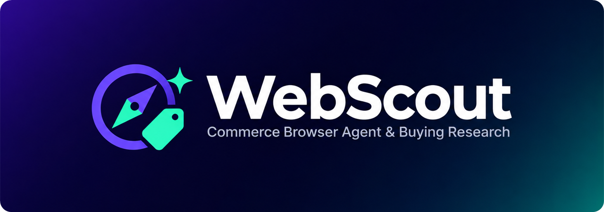
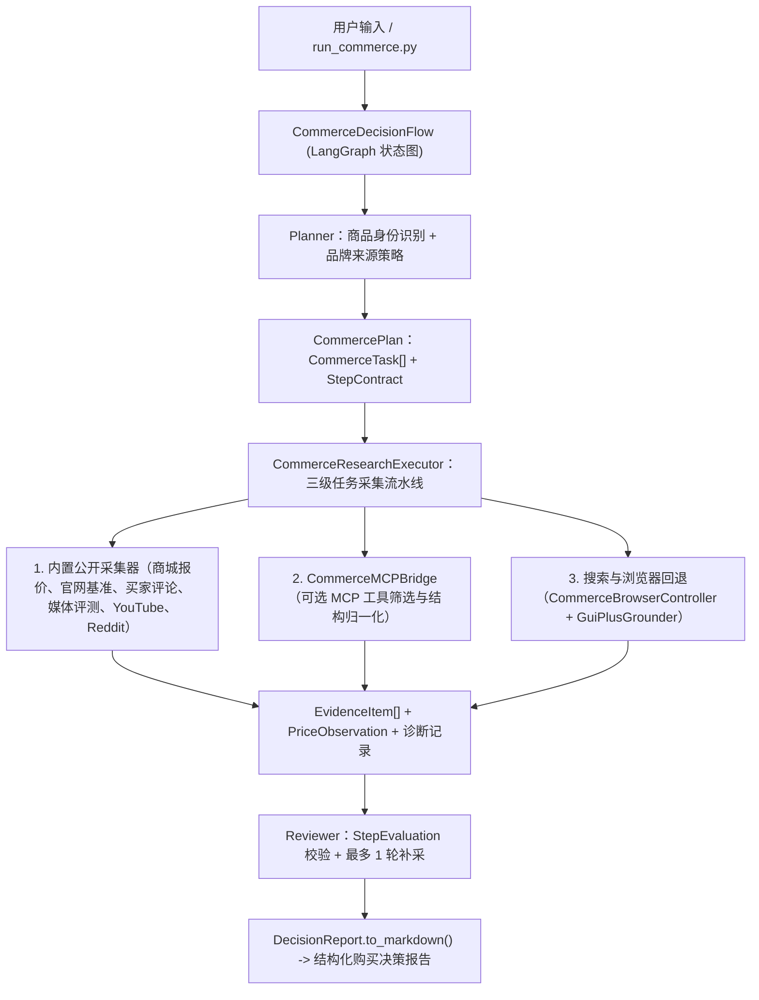

<p align="center">
  
</p>

# WebScout

[English](README.md) | 简体中文

WebScout 是基于 [OpenManus](https://github.com/FoundationAgents/OpenManus) 多工具智能体运行时演进构建的**跨平台电商商品调研、公开网页证据核验与购买决策报告 Agent**。

仓库的核心工作流（`run_commerce.py`）会把自由文本的商品调研需求拆解为受约束的采集计划，从主流电商平台、品牌官网、科技媒体专业评测、YouTube 视频评测以及 Reddit 社区讨论中收集公开证据，核对商品型号与配置可比性，最终输出结构化 Markdown 决策报告，并将“已核实报价”与“翻新/跨配置降级样本、登录墙/反爬拦截、缺失来源”明确区分开。

在电商调研主线之外，仓库完整保留了底层继承自 OpenManus 的通用多工具智能体（`main.py`）、多智能体规划流（`run_flow.py`）、MCP 客户端与服务端（`run_mcp.py`、`run_mcp_server.py`）、本地 Docker 与远程 Daytona 沙箱（`sandbox_main.py`、`app/sandbox/`）、图表可视化工具集（`app/tool/chart_visualization/`）以及实验性 A2A 协议服务端（`protocol/a2a/`）。

---

## 核心特性

- **策略驱动的商品深度对比（`product_compare_v2`）**：自动从用户输入中识别品牌、系列、品类、具体型号及硬件配置（尺寸、芯片、内存、存储、颜色、销售版本）。当用户只输入宽泛系列名（如 `"MacBook Pro"`）时，自动指定代表性基准型号（如 `Apple 14-inch MacBook Pro M5`）并在报告中显式声明，避免把不同尺寸或芯片的价格混在一起比较。
- **三级证据采集流水线**：`CommerceResearchExecutor` 对每个采集任务按固定优先级依次执行：
  1. **内置公开采集器（Direct Public Collectors，`app/mcp/commerce_public_server.py`）**：直接采集 Amazon、Best Buy、Walmart、Target、B&H、Newegg 等商城报价，Apple、Google Store、Samsung、Microsoft、Lenovo、Dell、HP、ASUS、Acer、Framework、Razer 等品牌官网基准，零售买家评论，The Verge、Wirecutter、RTINGS、Notebookcheck、GSMArena、CNET、PCMag 等 20 余家科技媒体评测，以及 YouTube 和 Reddit 公开讨论。
  2. **可选 MCP 桥接（`app/commerce/mcp_bridge.py`）**：按任务类别与平台自动匹配并调用 `config/mcp.json` 中配置的外部结构化工具（如 Bright Data MCP、Playwright MCP 或本地 SSE 比价服务），统一输出格式与超时诊断。
  3. **搜索与浏览器回退（`app/commerce/browser.py`、`app/commerce/grounding.py`）**：支持多搜索引擎检索、无头或本机会话浏览器提取、HTML 抓取回退，以及针对复杂网页结构的 DOM 候选打分与多模态视觉定位（`GuiPlusGrounder`）。
- **诚实的证据过滤与异常诊断**：自动剔除手机壳/配件、以旧换新折抵价、分期月供等不可比噪音；将翻新/二手（Renewed/Refurbished）或配置未对齐样本标记为降级参考；遇到登录门槛、验证码、地区选择页或限流时如实写入诊断说明，绝不伪造数据或静默替换平台。
- **有界 LangGraph 状态图编排**：通过 `planner -> executor -> reviewer` 节点（`CommerceDecisionFlow`）执行每一步的 `StepContract` 校验，记录失败签名（`failure_signature`），最多触发一轮针对缺失来源的补采，并自动跳过连续失败的同平台任务。
- **通用多工具与双沙箱基础设施**：保留 OpenManus 的 `Manus` 通用 Agent、`PlanningFlow` 多步规划、`DataAnalysis` 图表分析 Agent、本地 Docker 容器沙箱（`app/sandbox/`）以及支持 VNC 实时查看浏览器画面的 Daytona 云端沙箱（`sandbox_main.py`）。

---

## 架构概览

### 架构渊源与分层

1. **电商调研与决策层（核心维护主线）**：`run_commerce.py`、`app/flow/commerce.py`、`app/commerce/*`、`app/mcp/commerce_public_server.py`。
2. **通用智能体与协议层（继承自 OpenManus）**：`main.py`、`run_flow.py`、`run_mcp.py`、`run_mcp_server.py`、`sandbox_main.py`、`app/agent/*`、`app/tool/*`、`app/sandbox/*`、`app/daytona/*`、`protocol/a2a/*`。

### Commerce 调研数据流



---

## 环境要求

- **Python**：推荐 **Python 3.12**（代码使用标准库 `tomllib`，最低需 Python 3.11+；`setup.py` 与 `Dockerfile` 面向 3.12）。
- **大模型 API Key**：支持 OpenAI 兼容接口、Anthropic 兼容接口、Azure OpenAI、AWS Bedrock 或本地 Ollama，在 `config/config.toml` 中配置。
- **Playwright 浏览器**：用于本地网页打开与正文提取（`playwright install chromium`）。
- **按需可选组件**：
  - **Node.js >= 20**（含 `npx`）：仅在启用 `scripts/start_playwright_mcp.sh` 或 `scripts/start_brightdata_mcp.sh` 时需要。
  - **Node.js >= 18**（含 `npm`）：仅在使用 `app/tool/chart_visualization/` 图表工具时需要。
  - **Docker**：仅在启用 `[sandbox] use_sandbox = true` 或运行 `tests/sandbox/` 测试时需要。
  - **Daytona API Key**：仅在运行 `sandbox_main.py` 或使用 Daytona 远程浏览器后端时需要。

---

## 快速开始

### 1. 创建虚拟环境并安装依赖

```bash
uv venv --python 3.12
source .venv/bin/activate
uv pip install -r requirements.txt
playwright install chromium
```

Windows PowerShell 下激活虚拟环境：

```powershell
uv venv --python 3.12
.venv\Scripts\Activate.ps1
uv pip install -r requirements.txt
playwright install chromium
```

### 2. 配置模型与浏览器参数

复制配置模板并填入你的 API Key：

```bash
cp config/config.example.toml config/config.toml
```

`config/config.toml` 最小可用示例：

```toml
[llm]
model = "gpt-4o"
base_url = "https://api.openai.com/v1"
api_key = "YOUR_API_KEY"
max_tokens = 8192
temperature = 0.0

[llm.vision]
model = "gpt-4o"
base_url = "https://api.openai.com/v1"
api_key = "YOUR_API_KEY"
max_tokens = 8192
temperature = 0.0

[browser]
headless = true
session_mode = "public_only"
```

`config/` 目录下还提供了多模型与沙箱示例模板（`config.example-model-anthropic.toml`、`config.example-model-azure.toml`、`config.example-model-google.toml`、`config.example-model-ollama.toml`、`config.example-model-ppio.toml`、`config.example-model-jiekouai.toml`、`config.example-daytona.toml`）。

### 3. （可选）配置 MCP 服务

即使不配置外部 MCP 服务，`run_commerce.py` 也能直接通过内置公开采集器运行。如需接入外部 MCP 工具：

```bash
cp config/mcp.example.json config/mcp.json
```

- `commerce_public`：以 stdio 方式启动 `python -m app.mcp.commerce_public_server`（Windows 环境请将 `config/mcp.json` 中的 `./.venv/bin/python` 改为 `.venv/Scripts/python.exe`）。
- `playwright`：通过 `./scripts/start_playwright_mcp.sh` 调用 `@playwright/mcp@latest`。
- `brightdata`：通过 `./scripts/start_brightdata_mcp.sh` 调用 `@brightdata/mcp`；未设置 `BRIGHTDATA_API_TOKEN`、`BRIGHT_DATA_API_TOKEN` 或 `API_TOKEN` 环境变量时会自动跳过，不影响启动。
- `price_search`：连接本地 `http://localhost:8000/sse` SSE 服务。

> 请勿把真实密钥写入任何 `*.example.*` 模板文件。`config/config.toml` 与 `config/mcp.json` 已被 Git 忽略。

### 4. 运行商品调研并生成决策报告

```bash
# 稳定公开网页演示模式（不传 --prompt 时默认调研 iPhone 16）
python run_commerce.py \
  --demo-profile stable_public_web \
  --browser-session-mode public_only

# 策略化多来源深度对比（主力推荐模式）
python run_commerce.py \
  --execution-profile product_compare_v2 \
  --browser-session-mode public_only \
  --prompt "Compare current MacBook Pro prices on Amazon, Best Buy, Walmart, Target, B&H, and Newegg; summarize public retail customer review signals, professional editorial reviews, plus YouTube and Reddit real-user feedback; use public sources only and produce a detailed Chinese decision report with evidence, SKU caveats, price confidence, and buying recommendation."
```

最终 Markdown 报告会直接打印到标准输出（`stdout`），详细执行日志保存在 `logs/commerce_<时间戳>.log`。

---

## 全部入口脚本与命令行参数

### 1. 电商调研与决策入口（`run_commerce.py`）

```bash
python run_commerce.py [OPTIONS]
```

| 参数 | 可选值 / 默认值 | 说明 |
| --- | --- | --- |
| `--prompt TEXT` | 可选 | 调研请求文本。未提供时会交互式询问（`stable_public_web` 模式除外，未传时自动使用内置 iPhone 16 示例请求）。 |
| `--execution-profile` | `default`、`stable_public_web`、`product_compare_v2`（默认 `None`） | 显式指定执行档位；传入时会覆盖 `--demo-profile`。日常商品调研推荐使用 `product_compare_v2`。 |
| `--demo-profile` | `default`、`stable_public_web`（默认 `default`） | 演示档位快捷参数。 |
| `--browser-session-mode` | `auto`、`public_only`、`local_cdp`（默认 `None`） | 覆盖 `config/config.toml` 中的 `[browser] session_mode`。 |
| `--timeout-seconds INT` | `900` | 整条调研流程的总超时时间（秒）。 |

**浏览器会话模式说明**：

| 模式 | 实际行为 |
| --- | --- |
| `public_only` | 仅使用公开网页与搜索链路，不读取本机 Chrome 会话，适合可复现测试。 |
| `auto` | 默认走公开路径；遇到 Amazon、Best Buy、Walmart、京东、淘宝等高门槛站点时，可切换至已配置的 CDP/Chrome 实例或自动发现的本机 Chromium 配置目录（`~/.cache/openmanus/commerce-browser-profile`）。 |
| `local_cdp` | 强制要求在 `config/config.toml` 中配置 `browser.cdp_url`、`browser.wss_url` 或 `browser.chrome_instance_path`，未配置则启动时报错退出。 |

WebScout 不会自动破解验证码、绕过登录限制或对抗站点反爬机制；受限页面会作为结构化诊断信息呈现在报告中。

### 2. 通用多工具 Agent（`main.py`）

运行继承自 OpenManus 的 `Manus` 智能体，内置 Python 代码执行、网页搜索、浏览器操作、文件编辑（`str_replace_editor`）、人工确认（`ask_human`）及已配置的 MCP 工具：

```bash
python main.py --prompt "整理 workspace 目录下的文件并输出摘要"
```

### 3. 多智能体规划流（`run_flow.py`）

读取 `config/config.toml` 中的 `[runflow]` 配置（`flow_type = "planning"` 或 `"commerce_decision"`，`use_data_analysis_agent = false | true`），交互式输入任务并执行（总超时 3600 秒）：

```bash
python run_flow.py
```

### 4. MCP 客户端与服务端（`run_mcp.py`、`run_mcp_server.py`）

```bash
# 启动通用工具 MCP 服务端（stdio 模式，暴露 bash、browser、editor、terminate）
python run_mcp_server.py --transport stdio

# 启动公开电商采集器 MCP 服务端（stdio 模式，暴露 7 个电商采集工具）
python -m app.mcp.commerce_public_server --transport stdio

# 使用 MCPAgent 连接 stdio 或 SSE 服务端
python run_mcp.py --connection stdio --interactive
python run_mcp.py --connection sse --server-url http://127.0.0.1:8000/sse --prompt "列出当前可用工具"
```

### 5. Daytona 云端沙箱 Agent（`sandbox_main.py`）

在远程 Daytona 容器内运行 `SandboxManus`，调用 `sandbox_browser`、`sandbox_files`、`sandbox_shell`、`sandbox_vision` 工具（需在 `config/config.toml` 配置 `[daytona]`）：

```bash
python sandbox_main.py --prompt "在沙箱浏览器中打开 example.com 并将页面摘要保存为 /workspace/index.html"
```

### 6. 实验性 A2A 协议服务端（`protocol/a2a/app/main.py`）

通过 Google A2A（Agent2Agent）协议将 `A2AManus` 暴露为 HTTP JSON-RPC 服务（需额外安装 `pip install a2a-sdk==0.2.5 python-dotenv`）：

```bash
python -m protocol.a2a.app.main --host localhost --port 10000
```

---

## 目录结构

```text
WebScout/
├── run_commerce.py                # 电商商品调研与购买决策报告主入口 CLI
├── main.py                        # Manus 通用多工具 Agent CLI
├── run_flow.py                    # 多步规划流 / 电商决策流统一运行器
├── run_mcp.py                     # MCP 客户端 Agent CLI（支持 stdio / SSE）
├── run_mcp_server.py              # 通用工具 MCP stdio 服务端入口
├── sandbox_main.py                # Daytona 远程沙箱 Agent CLI
├── app/
│   ├── commerce/                  # 电商数据契约、来源策略、采集执行器、MCP 桥接、浏览器控制、视觉定位
│   ├── flow/                      # LangGraph CommerceDecisionFlow、PlanningFlow、FlowFactory
│   ├── mcp/                       # CommercePublicMCPServer（内置公开采集器）与通用 MCPServer
│   ├── agent/                     # Manus、SandboxManus、DataAnalysis、SWEAgent、BrowserAgent、MCPAgent
│   ├── tool/                      # 搜索、BrowserUse、Python 执行、Crawl4AI、文件编辑、图表可视化
│   ├── sandbox/                   # 本地 Docker 沙箱管理器、容器客户端、异步终端
│   ├── daytona/                   # 远程 Daytona 沙箱生命周期管理与工具基类
│   ├── config.py                  # TOML 与 MCP JSON 单例配置加载器
│   └── llm.py                     # OpenAI / Azure / Bedrock / 视觉模型封装与 Token 统计
├── config/                        # 模型与 Daytona 配置模板、mcp.example.json
├── scripts/                       # Playwright MCP 与 Bright Data MCP 启动脚本
├── protocol/a2a/                  # 实验性 A2A 协议服务端适配
├── examples/use_case/             # 运行产物示例（日本旅行手册多版本 HTML）
├── docs/                          # Commerce Agent 实战指南与技术演进记录
└── tests/
    ├── commerce/                  # 电商流程、执行器、MCP 桥接、浏览器与模型单元测试
    └── sandbox/                   # 本地 Docker 沙箱集成测试
```

---

## 测试与自检

运行电商模块测试套件（纯离线 Mock，无需外部网络或真实 API Key）：

```bash
python -m pytest tests/commerce -q
```

运行本地 Docker 沙箱测试（需本机已启动 Docker 服务）：

```bash
python -m pytest tests/sandbox -q
```

对核心模块执行语法编译检查：

```bash
python -m py_compile \
  run_commerce.py \
  app/flow/commerce.py \
  app/commerce/executor.py \
  app/commerce/mcp_bridge.py \
  app/commerce/browser.py \
  app/commerce/grounding.py \
  app/commerce/models.py \
  app/commerce/policy.py \
  app/mcp/commerce_public_server.py
```

---

## 子文档导航

- **Commerce Agent 实战与架构指南**：[English](docs/commerce-agent.md) | [简体中文](docs/commerce-agent.zh.md)
- **Commerce 模块代码说明**：[app/commerce/README.md](app/commerce/README.md)
- **开发与维护规范**：[AGENT.md](AGENT.md)
- **Daytona 云端沙箱指南**：[app/daytona/README.md](app/daytona/README.md)
- **图表可视化工具文档**：[English](app/tool/chart_visualization/README.md) | [简体中文](app/tool/chart_visualization/README_zh.md) | [日本語](app/tool/chart_visualization/README_ja.md) | [한국어](app/tool/chart_visualization/README_ko.md)
- **A2A 协议集成说明**：[English](protocol/a2a/app/README.md) | [简体中文](protocol/a2a/app/README_zh.md)
- **应用案例复现指南**：[examples/use_case/readme.md](examples/use_case/readme.md)
- **Commerce 技术设计与优化记录**：
  - [浏览器控制流规格说明](docs/superpowers/specs/2026-04-19-commerce-browser-control-loop-design.md)
  - [浏览器控制流实现记录](docs/superpowers/plans/2026-04-19-commerce-browser-control-loop.md)
  - [报告深度优化实现记录](docs/superpowers/plans/2026-04-20-commerce-report-depth-optimization.md)
  - [报告交付质量优化实现记录](docs/superpowers/plans/2026-04-20-commerce-report-quality-optimization.md)

---

## 开源协议

本项目基于 [MIT License](LICENSE) 开源，底层通用智能体框架演进自 [OpenManus](https://github.com/FoundationAgents/OpenManus)。
