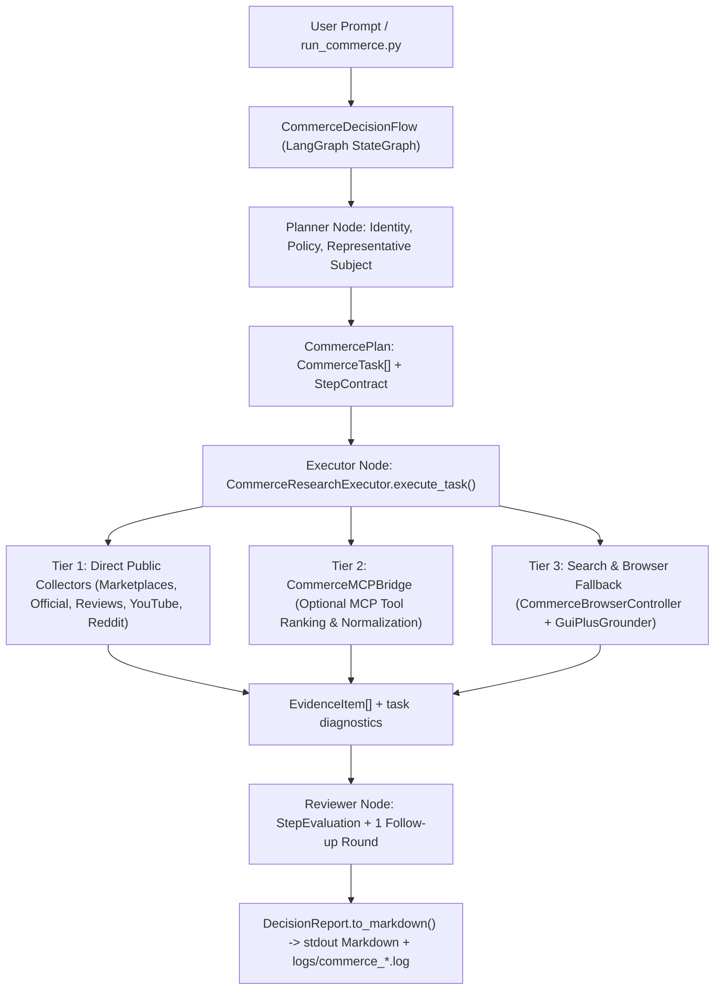
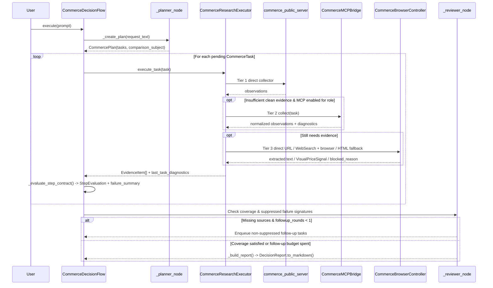
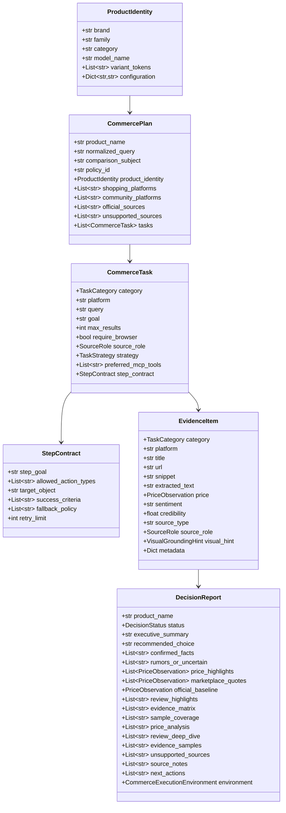

# Commerce Agent Guide & Architecture

English | [简体中文](commerce-agent.zh.md)

The WebScout Commerce Agent (`run_commerce.py` + `app/flow/commerce.py` + `app/commerce/*`) is a dedicated product research, public-web collection, and purchase-decision report system built on top of the OpenManus runtime.

Rather than wrapping a generic browser loop in a single prompt, it separates product identity extraction, brand/category source policy, 3-tier evidence collection, per-step contract verification, and structured report synthesis into independent, testable components.

---

## 1. Execution Profiles

| Profile | CLI Flag | Purpose | Best For |
| --- | --- | --- | --- |
| `product_compare_v2` | `--execution-profile product_compare_v2` | Policy-driven multi-source comparison & review synthesis | **Main workflow**: phones, laptops, tablets, audio, wearables, consoles, and general consumer products |
| `stable_public_web` | `--demo-profile stable_public_web` or `--execution-profile stable_public_web` | Deterministic 4-source public-web demo (Amazon, Best Buy, YouTube, Apple.com) | Quick smoke checks and repeatable iPhone 16 demo runs (uses a built-in prompt if `--prompt` is omitted) |
| `default` | `--execution-profile default` (default when no profile is passed) | Heuristic fast-path or LLM-planned investigation (`PLANNER_SYSTEM_PROMPT`) | Ad-hoc CN/EN shopping queries (supports JD, Taobao, Tmall, Pinduoduo, Xiaohongshu, Bilibili, Weibo, Amazon, Best Buy, Reddit, YouTube) |

---

## 2. CLI Reference (`run_commerce.py`)

```bash
python run_commerce.py [OPTIONS]
```

| Flag | Choices / Default | Description |
| --- | --- | --- |
| `--prompt TEXT` | Optional | Free-form product research request. Prompts interactively in the terminal if omitted (except under `stable_public_web`, which defaults to `DEFAULT_STABLE_PUBLIC_WEB_PROMPT`). |
| `--execution-profile` | `default`, `stable_public_web`, `product_compare_v2` (`None`) | Explicit execution profile. Takes precedence over `--demo-profile` when both are provided. |
| `--demo-profile` | `default`, `stable_public_web` (`default`) | Optional demo profile selector. |
| `--browser-session-mode` | `auto`, `public_only`, `local_cdp` (`None`) | Overrides `[browser] session_mode` in `config/config.toml` via `config.set_browser_session_mode()`. |
| `--timeout-seconds INT` | `900` | Overall `asyncio.wait_for` timeout (seconds) for `flow.execute(prompt)`. |

### Example Commands

```bash
# 1. Repeatable public-web demo
python run_commerce.py \
  --demo-profile stable_public_web \
  --browser-session-mode public_only

# 2. Multi-marketplace phone comparison with retail, editorial, YouTube, and Reddit signals
python run_commerce.py \
  --execution-profile product_compare_v2 \
  --browser-session-mode public_only \
  --prompt "Compare iPhone 16 prices on Amazon, Best Buy, Walmart, Target, B&H, and Newegg; summarize public retail customer review signals, professional editorial reviews, plus YouTube and Reddit real-user feedback."

# 3. Broad laptop family prompt (automatically narrows to a representative comparable model)
python run_commerce.py \
  --execution-profile product_compare_v2 \
  --browser-session-mode public_only \
  --timeout-seconds 600 \
  --prompt "Compare current MacBook Pro prices on Amazon, Best Buy, Walmart, Target, B&H, and Newegg; summarize public retail customer review signals, professional editorial reviews, plus YouTube and Reddit real-user feedback; use public sources only and produce a detailed Chinese decision report with evidence, SKU caveats, price confidence, and buying recommendation."
```

---

## 3. Configuration & Optional MCP Scripts

### `config/config.toml`

Copy `config/config.example.toml` to `config/config.toml`:

- **`[llm]`**: Primary model used for planning (in `default` profile) and review synthesis (`REVIEW_HIGHLIGHT_SYNTHESIZER_SYSTEM_PROMPT`).
- **`[llm.vision]`**: Optional multimodal model used by `GuiPlusGrounder` (`app/commerce/grounding.py`) when page text extraction is sparse or missing visible price signals.
- **`[browser]`**:
  - `headless`: `true` or `false` (default `false`).
  - `session_mode`: `"auto"`, `"public_only"`, or `"local_cdp"`.
  - `cdp_url` / `wss_url` / `chrome_instance_path`: Optional local Chrome connection settings for `auto` and `local_cdp` modes.
  - `[browser.proxy]`: Optional `server`, `username`, `password`.
- **`[search]`**: Primary `engine` (`"Google"`, `"DuckDuckGo"`, `"Baidu"`, `"Bing"`), `fallback_engines`, `retry_delay`, `max_retries`, `lang`, `country`.
- **`[daytona]`**: Optional remote cloud sandbox settings; when present, `CommerceBrowserController` uses `SandboxBrowserTool` (`daytona_sandbox`) for public browsing.

### `config/mcp.json` & Helper Scripts

Copy `config/mcp.example.json` to `config/mcp.json` to enable optional MCP providers behind `CommerceMCPBridge`:

1. **`commerce_public`** (`python -m app.mcp.commerce_public_server --transport stdio`)
   - Built-in FastMCP server exposing 7 public commerce tools: `price_benchmark_search`, `marketplace_price_search`, `official_catalog_search`, `marketplace_customer_review_search`, `youtube_video_review_search`, `reddit_community_review_search`, and `editorial_web_review_search`.
   - Note: On Windows, change `"command": "./.venv/bin/python"` in `config/mcp.json` to `".venv/Scripts/python.exe"`.

2. **`playwright`** (`./scripts/start_playwright_mcp.sh`)
   - Launches `npx -y -p node@20 -p @playwright/mcp@latest` in headless file-output mode (`--headless --no-sandbox --output-mode file`).
   - Supported environment variables:
     - `PLAYWRIGHT_MCP_OUTPUT_DIR`: Snapshot output directory (default `/tmp/openmanus_playwright_mcp`).
     - `PLAYWRIGHT_MCP_EXECUTABLE_PATH`: Explicit Chromium binary path (auto-discovers local `ms-playwright` Chromium cache on Linux/macOS/Windows if unset).
     - `PLAYWRIGHT_MCP_USER_DATA_DIR`: Persistent browser profile directory (defaults to a temporary `/tmp/openmanus_playwright_mcp_profile.XXXXXX` directory).

3. **`brightdata`** (`./scripts/start_brightdata_mcp.sh`)
   - Launches `npx -y -p node@20 -p @brightdata/mcp -c 'mcp'`.
   - Guarded in `config/mcp.example.json` by `"required_env_any": ["BRIGHTDATA_API_TOKEN", "BRIGHT_DATA_API_TOKEN", "API_TOKEN"]`—if none of these variables is set in your shell, `MCPSettings.load_server_config()` skips `brightdata` cleanly at startup.
   - Supported environment variables in `start_brightdata_mcp.sh`:
     - `BRIGHTDATA_API_TOKEN` / `BRIGHT_DATA_API_TOKEN` / `API_TOKEN` (required when invoking the script directly).
     - `BRIGHTDATA_PRO_MODE`: Exported as `PRO_MODE` (default `"true"`).
     - `BRIGHTDATA_GROUPS`: Exported as `GROUPS` (default `"ecommerce,browser"`).

4. **`price_search`** (`http://localhost:8000/sse`)
   - Optional SSE MCP endpoint for custom local price services. Set `"disabled": true` in `config/mcp.json` if you do not run an SSE server on port 8000.

---

## 4. Architecture & Runtime Pipeline



### Runtime Sequence



### Data Model (`app/commerce/models.py`)



### Representative Model Narrowing (`product_compare_v2`)

When a prompt names a configuration-sensitive product family without specifying size, chip, memory, or storage, `_series_comparison_subject()` selects a single representative baseline so marketplace quotes remain comparable:

| Broad Prompt Input | Internal `comparison_subject` | Report Behavior |
| --- | --- | --- |
| `MacBook Pro` | `Apple 14-inch MacBook Pro M5` | Labeled as representative baseline; unaligned sizes/chips are marked `degraded_marketplace` |
| `MacBook Air` | `Apple 13-inch MacBook Air M4` | Labeled as representative baseline |

If you want a specific SKU (for example `16-inch MacBook Pro M4 Pro 24GB 512GB`), include those parameters directly in `--prompt`.

---

## 5. Output Structure & Artifacts

1. **Standard Output (`stdout`)**: `run_commerce.py` suppresses noisy third-party/subprocess output during execution and prints the final Markdown report generated by `DecisionReport.to_markdown()`. Sections include:
   - `# <Product> 决策报告`
   - `## 执行摘要` (Executive summary)
   - `## 完成状态` (`已完成` / `部分完成` / `未完成`)
   - `## 推荐结论` (Buying recommendation & SKU warnings)
   - `## 已确认信息` & `## 传闻与不确定项`
   - `## 价格观察` & `## 官方基准`
   - `## 证据矩阵` (Markdown table across planned sources when populated)
   - `## 口碑主题` (LLM-synthesized or rule-derived pros, cons, upgrade value, user fit)
   - `## 样本覆盖`, `## 价格与配置分析`, `## 口碑深挖`, `## 样本摘录`
   - `## 不支持来源`, `## 来源备注`, `## 后续建议`, `## 运行环境`
   - Save directly to a file when needed: `python run_commerce.py ... > report.md`.
2. **Runtime Logs**: Detailed step logs, tool calls, diagnostics, and token counts are written to `logs/commerce_<YYYYMMDDHHMMSS>.log`.
3. **Browser & MCP Cache Directories**:
   - Auto-discovered local Chromium session profile (`auto` mode): `~/.cache/openmanus/commerce-browser-profile`
   - Playwright MCP file snapshots (when `playwright` MCP is enabled): `/tmp/openmanus_playwright_mcp`

---

## 6. Browser Session Modes

| Mode | Behavior | When to Use |
| --- | --- | --- |
| `public_only` | Uses public search/fetch/browser paths only; skips `_build_session_runtime()`. | Reproducible CI/CLI runs with zero dependence on local logged-in browsers. |
| `auto` | Uses public paths by default; switches session-preferred platforms (`Amazon`, `Best Buy`, `Walmart`, `JD`, `Taobao`, `Tmall`, `Pinduoduo`, `Xiaohongshu`, `Weibo`) or blocked public pages to a configured CDP/Chrome session or auto-discovered local Chromium binary. | Local desktop runs where reusing a browser profile reduces country-selector or guest walls. |
| `local_cdp` | Requires `browser.cdp_url`, `browser.wss_url`, or `browser.chrome_instance_path` in `config/config.toml`. | Debugging against an explicitly launched Chrome `--remote-debugging-port=9222` instance. |

WebScout never solves or bypasses CAPTCHAs, login prompts, or anti-bot verification pages.

---

## 7. Troubleshooting

- **`ValueError: browser.session_mode=local_cdp requires browser.cdp_url, browser.wss_url, or browser.chrome_instance_path.`**
  - Switch to `--browser-session-mode public_only` (or `auto`), or set `cdp_url = "http://127.0.0.1:9222"` under `[browser]` in `config/config.toml` after starting Chrome with `--remote-debugging-port=9222`.
- **Report status is `部分完成` (`partial`) or `未完成` (`incomplete`) in `public_only` mode**
  - Check `## 来源备注` and `## 传闻与不确定项` in the generated report. Sites like Amazon, Best Buy, Google Store, or Reddit (`HTTP 429`) frequently serve login gates, country selectors, or bot checks to unauthenticated traffic. WebScout intentionally marks those sources as missing/blocked instead of guessing prices.
- **`Failed to connect MCP server commerce_public` on Windows**
  - `config/mcp.example.json` uses `./.venv/bin/python` (POSIX path). Update `"command"` in `config/mcp.json` to `".venv/Scripts/python.exe"`, or remove `commerce_public` from `config/mcp.json` (`product_compare_v2` already calls its collectors directly in-process).
- **`Failed to connect MCP server price_search` (`http://localhost:8000/sse`)**
  - `price_search` in `config/mcp.example.json` expects a running local SSE server. Add `"disabled": true` to the `price_search` entry in `config/mcp.json` if you are not running one; `CommerceMCPBridge` logs a warning and continues either way.
- **`Commerce flow timed out after 900 seconds`**
  - Increase `--timeout-seconds` (e.g. `--timeout-seconds 1200`), narrow the number of marketplaces in `--prompt`, or check `logs/commerce_<timestamp>.log` to see whether an LLM endpoint or external search engine is stalling.
