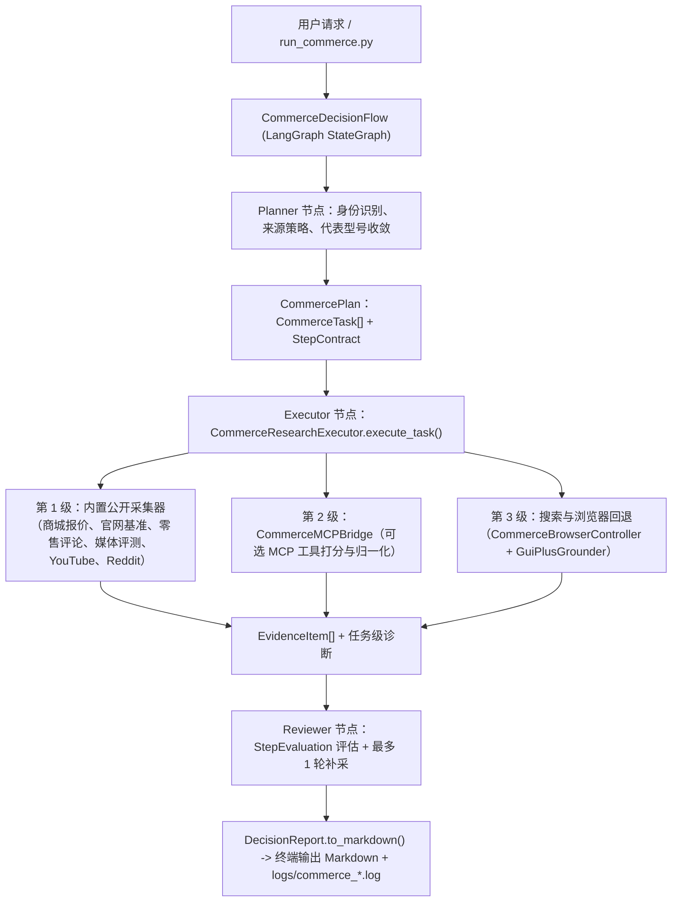
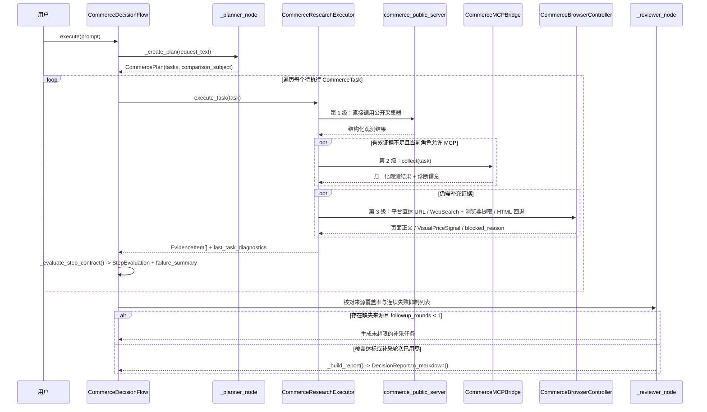
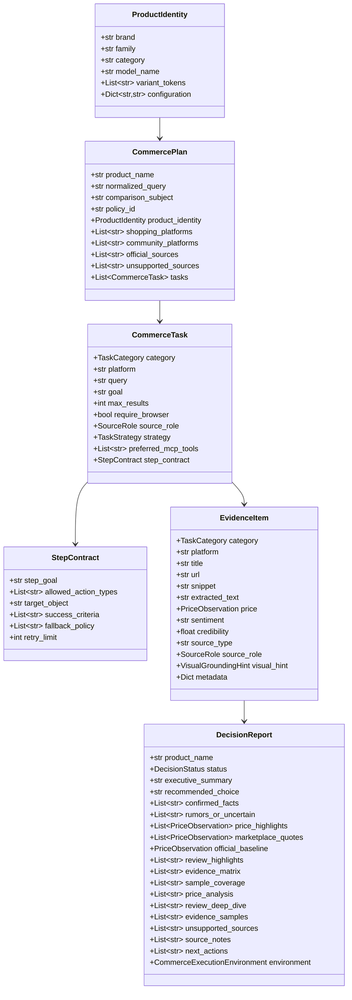

# Commerce Agent 实战与架构指南

[English](commerce-agent.md) | 简体中文

WebScout Commerce Agent（`run_commerce.py` + `app/flow/commerce.py` + `app/commerce/*`）是在 OpenManus 运行时之上构建的商品调研、公开网页采集与购买决策报告系统。

它不是在通用浏览器循环外简单套一层提示词，而是把**商品身份解析、品牌与品类来源策略、三级证据采集、单步契约（`StepContract`）核验、结构化报告合成**拆分为边界清晰、可独立测试的模块。

---

## 1. 执行档位（Execution Profiles）

| 档位 | 启动参数 | 定位 | 适用场景 |
| --- | --- | --- | --- |
| `product_compare_v2` | `--execution-profile product_compare_v2` | 策略驱动的多来源比价与多维口碑汇总 | **主力推荐路径**：覆盖手机、笔记本、平板、耳机音频、智能穿戴、游戏主机及常见消费电子商品 |
| `stable_public_web` | `--demo-profile stable_public_web` 或 `--execution-profile stable_public_web` | 固定 4 来源（Amazon、Best Buy、YouTube、Apple.com）的公开网页演示 | 快速冒烟验证与可重复演示（不传 `--prompt` 时自动使用内置 iPhone 16 请求） |
| `default` | `--execution-profile default`（未指定档位时的默认值） | 启发式快速规则或大模型动态规划（`PLANNER_SYSTEM_PROMPT`） | 临时中英文自由比价调研（支持京东、淘宝、天猫、拼多多、小红书、Bilibili、微博及海外主流站点） |

---

## 2. 命令行参数详解（`run_commerce.py`）

```bash
python run_commerce.py [OPTIONS]
```

| 参数 | 可选值 / 默认值 | 说明 |
| --- | --- | --- |
| `--prompt TEXT` | 可选 | 用户的商品调研需求文本。未传入时会在终端交互式提示输入（`stable_public_web` 除外，未传时默认采用 `DEFAULT_STABLE_PUBLIC_WEB_PROMPT`）。 |
| `--execution-profile` | `default`、`stable_public_web`、`product_compare_v2`（默认 `None`） | 显式指定执行档位；同时传入 `--demo-profile` 时以 `--execution-profile` 为准。 |
| `--demo-profile` | `default`、`stable_public_web`（默认 `default`） | 演示档位快捷参数。 |
| `--browser-session-mode` | `auto`、`public_only`、`local_cdp`（默认 `None`） | 覆盖 `config/config.toml` 中的 `[browser] session_mode`。 |
| `--timeout-seconds INT` | `900` | 整条调研流程的总超时秒数（默认 15 分钟）。 |

### 常用运行命令示例

```bash
# 1. 稳定公开网页演示模式
python run_commerce.py \
  --demo-profile stable_public_web \
  --browser-session-mode public_only

# 2. 手机多平台比价 + 零售评论 / 专业媒体评测 / YouTube / Reddit 口碑汇总
python run_commerce.py \
  --execution-profile product_compare_v2 \
  --browser-session-mode public_only \
  --prompt "Compare iPhone 16 prices on Amazon, Best Buy, Walmart, Target, B&H, and Newegg; summarize public retail customer review signals, professional editorial reviews, plus YouTube and Reddit real-user feedback."

# 3. 宽泛笔记本系列请求（自动收敛至代表性可比型号，避免跨尺寸/芯片混算）
python run_commerce.py \
  --execution-profile product_compare_v2 \
  --browser-session-mode public_only \
  --timeout-seconds 600 \
  --prompt "Compare current MacBook Pro prices on Amazon, Best Buy, Walmart, Target, B&H, and Newegg; summarize public retail customer review signals, professional editorial reviews, plus YouTube and Reddit real-user feedback; use public sources only and produce a detailed Chinese decision report with evidence, SKU caveats, price confidence, and buying recommendation."
```

---

## 3. 配置文件与 MCP 启动脚本

### `config/config.toml`

将 `config/config.example.toml` 复制为 `config/config.toml` 后按需修改：

- **`[llm]`**：主模型配置，用于 `default` 档位的任务规划以及各档位的口碑亮点提炼（`REVIEW_HIGHLIGHT_SYNTHESIZER_SYSTEM_PROMPT`）。
- **`[llm.vision]`**：可选视觉多模态模型配置，供 `GuiPlusGrounder`（`app/commerce/grounding.py`）在网页正文抽取不足或缺少价格字段时辅助分析截图。
- **`[browser]`**：
  - `headless`：是否无头运行浏览器（默认 `false`）。
  - `session_mode`：`"auto"`、`"public_only"` 或 `"local_cdp"`。
  - `cdp_url` / `wss_url` / `chrome_instance_path`：连接本机已有 Chrome 实例的参数（`local_cdp` 必填，`auto` 可选）。
  - `[browser.proxy]`：可选浏览器代理（`server`、`username`、`password`）。
- **`[search]`**：搜索引擎配置（主引擎 `engine` 默认 `"Google"`，回退链 `fallback_engines` 默认 `["DuckDuckGo", "Baidu", "Bing"]`，以及 `retry_delay`、`max_retries`、`lang`、`country`）。
- **`[daytona]`**：可选远程沙箱配置；启用后 `CommerceBrowserController` 会优先把 `SandboxBrowserTool`（`daytona_sandbox`）作为公开浏览器后端。

### `config/mcp.json` 与辅助启动脚本

将 `config/mcp.example.json` 复制为 `config/mcp.json` 即可为 `CommerceMCPBridge` 挂载可选外部工具：

1. **`commerce_public`**（`python -m app.mcp.commerce_public_server --transport stdio`）
   - 内置公开采集 FastMCP 服务，暴露 7 个工具：`price_benchmark_search`、`marketplace_price_search`、`official_catalog_search`、`marketplace_customer_review_search`、`youtube_video_review_search`、`reddit_community_review_search`、`editorial_web_review_search`。
   - Windows 注意事项：`config/mcp.example.json` 中默认写了 POSIX 路径 `./.venv/bin/python`，在 Windows 上请改为 `.venv/Scripts/python.exe`。

2. **`playwright`**（`./scripts/start_playwright_mcp.sh`）
   - 通过 `npx -y -p node@20 -p @playwright/mcp@latest` 启动无头 Playwright MCP 服务（`--headless --no-sandbox --output-mode file`）。
   - 支持的环境变量：
     - `PLAYWRIGHT_MCP_OUTPUT_DIR`：快照文件输出目录（默认 `/tmp/openmanus_playwright_mcp`）。
     - `PLAYWRIGHT_MCP_EXECUTABLE_PATH`：指定本机 Chromium 可执行文件路径（未设置时自动扫描 Linux / macOS / Windows 的 `ms-playwright` 缓存目录）。
     - `PLAYWRIGHT_MCP_USER_DATA_DIR`：浏览器用户数据目录（未设置时自动在 `/tmp` 下创建临时目录）。

3. **`brightdata`**（`./scripts/start_brightdata_mcp.sh`）
   - 通过 `npx -y -p node@20 -p @brightdata/mcp -c 'mcp'` 启动 Bright Data 结构化网页数据服务。
   - `config/mcp.example.json` 配置了 `"required_env_any": ["BRIGHTDATA_API_TOKEN", "BRIGHT_DATA_API_TOKEN", "API_TOKEN"]`：只要这三个环境变量都未设置，`MCPSettings.load_server_config()` 会在启动时自动跳过该服务，不会报错。
   - 脚本支持的环境变量：
     - `BRIGHTDATA_API_TOKEN` / `BRIGHT_DATA_API_TOKEN` / `API_TOKEN`：Bright Data API 令牌（直接运行脚本时必填）。
     - `BRIGHTDATA_PRO_MODE`：映射为 `PRO_MODE`（默认 `"true"`）。
     - `BRIGHTDATA_GROUPS`：映射为 `GROUPS`（默认 `"ecommerce,browser"`）。

4. **`price_search`**（`http://localhost:8000/sse`）
   - 本地自定义比价 SSE 服务示例。若本地未启动 8000 端口服务，可在 `config/mcp.json` 中为该项添加 `"disabled": true`。

---

## 4. 总体架构与运行流水线



### 运行时交互时序



### 核心数据契约（`app/commerce/models.py`）



### 配置敏感商品的代表型号收敛（`product_compare_v2`）

当用户只给出配置敏感商品的宽泛系列名而未指定尺寸、芯片、内存或存储时，`_series_comparison_subject()` 会选定单一代表型号作为比价基准：

| 宽泛输入 | 内部 `comparison_subject` | 报告处理方式 |
| --- | --- | --- |
| `MacBook Pro` | `Apple 14-inch MacBook Pro M5` | 显式标注为代表型号；未对齐尺寸/芯片的报价标记为 `degraded_marketplace` |
| `MacBook Air` | `Apple 13-inch MacBook Air M4` | 显式标注为代表型号 |

如果需要对比特定配置（如 `16-inch MacBook Pro M4 Pro 24GB 512GB`），请在 `--prompt` 中直接写明规格参数。

---

## 5. 输出产物与报告结构

1. **标准输出（`stdout`）**：`run_commerce.py` 在执行期间会屏蔽底层库与子进程的杂音输出，最后只将 `DecisionReport.to_markdown()` 生成的完整报告打印到 `stdout`，可直接重定向保存（`python run_commerce.py ... > report.md`）。报告包含以下章节：
   - `# <商品名称> 决策报告`
   - `## 执行摘要`
   - `## 完成状态`（`已完成` / `部分完成` / `未完成`）
   - `## 推荐结论`
   - `## 已确认信息` 与 `## 传闻与不确定项`
   - `## 价格观察` 与 `## 官方基准`
   - `## 证据矩阵`（各计划来源的命中状态与样本概览表）
   - `## 口碑主题`（核心卖点、槽点与争议、价格与升级价值、长期使用风险、目标人群画像、总结性评价）
   - `## 样本覆盖`、`## 价格与配置分析`、`## 口碑深挖`、`## 样本摘录`
   - `## 不支持来源`、`## 来源备注`、`## 后续建议`、`## 运行环境`
2. **运行日志**：完整的任务调度、工具耗时、异常诊断与 Token 用量保存在 `logs/commerce_<YYYYMMDDHHMMSS>.log`。
3. **浏览器与 MCP 缓存目录**：
   - `auto` 模式自动发现本机 Chromium 时使用的配置目录：`~/.cache/openmanus/commerce-browser-profile`
   - `playwright` MCP 快照输出目录：`/tmp/openmanus_playwright_mcp`

---

## 6. 浏览器会话模式对比

| 模式 | 行为说明 | 适用场景 |
| --- | --- | --- |
| `public_only` | 只使用公开搜索、公开抓取与无登录态浏览器，跳过 `_build_session_runtime()`。 | 可复现验收、服务器无桌面环境、希望完全不依赖个人登录态。 |
| `auto` | 默认走公开路径；对 `Amazon`、`Best Buy`、`Walmart`、`JD`、`Taobao`、`Tmall`、`Pinduoduo`、`Xiaohongshu`、`Weibo` 等站点或公开页受阻场景，切换至已配置的 CDP/Chrome 或自动发现的本机 Chromium 会话。 | 本机桌面环境运行，希望减少地区选择弹窗或访客拦截。 |
| `local_cdp` | 强制要求 `config/config.toml` 配置 `browser.cdp_url`、`browser.wss_url` 或 `browser.chrome_instance_path`。 | 连接手动通过 `--remote-debugging-port=9222` 启动的本机 Chrome 进行调试。 |

所有模式均严格遵守访问边界，不提供验证码识别破解、登录绕过或反爬对抗功能。

---

## 7. 常见报错与排错指南

- **启动报错 `ValueError: browser.session_mode=local_cdp requires browser.cdp_url, browser.wss_url, or browser.chrome_instance_path.`**
  - 原因：指定了 `local_cdp` 模式，但 `config/config.toml` 未提供任何本地浏览器连接地址。
  - 解决：改用 `--browser-session-mode public_only`（或 `auto`），或在手动启动带 `--remote-debugging-port=9222` 的 Chrome 后在 `[browser]` 下配置 `cdp_url = "http://127.0.0.1:9222"`。
- **`public_only` 下报告显示 `部分完成` 或部分平台无报价**
  - 原因：Amazon、Best Buy、Google Store 或 Reddit（`HTTP 429`）对未登录流量经常返回登录墙、国家/地区选择页或人机验证页。
  - 解决：查看报告底部的 `## 来源备注` 与 `## 传闻与不确定项` 确认具体拦截原因（如 `login_required`、`country_selector`、`verification_required`）；如需复用本机浏览器正常会话，可配置 Chrome CDP 后使用 `--browser-session-mode auto`。
- **Windows 下日志提示 `Failed to connect MCP server commerce_public`**
  - 原因：`config/mcp.example.json` 默认命令为 `./.venv/bin/python`（Linux/macOS 路径）。
  - 解决：将 `config/mcp.json` 中的路径改为 `.venv/Scripts/python.exe`；另外在 `product_compare_v2` 和 `stable_public_web` 模式下，执行器会直接进程内调用公开采集器，即使不启用 `commerce_public` 子进程也不影响主流程。
- **日志提示 `Failed to connect MCP server price_search`**
  - 原因：`config/mcp.example.json` 中的 `price_search` 指向 `http://localhost:8000/sse`，本机未启动对应服务时会连接失败并自动降级。
  - 解决：不需要该服务时，在 `config/mcp.json` 的 `price_search` 中添加 `"disabled": true` 即可消除告警。
- **执行超时 `Commerce flow timed out after 900 seconds.`**
  - 解决：通过 `--timeout-seconds 1200` 调大总超时，精简单次 `--prompt` 中同时指定的电商平台数量，或打开 `logs/commerce_<时间戳>.log` 排查是哪个搜索引擎或大模型接口响应缓慢。
